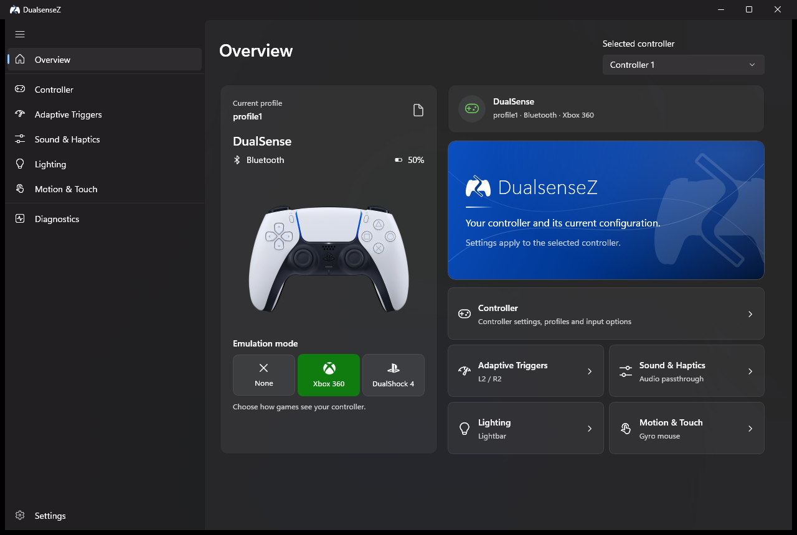
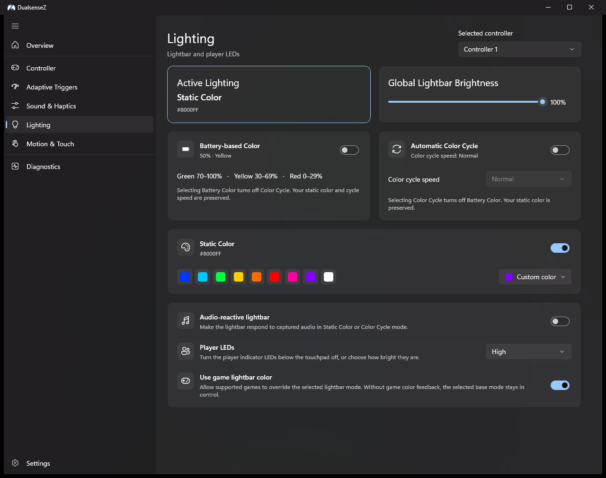
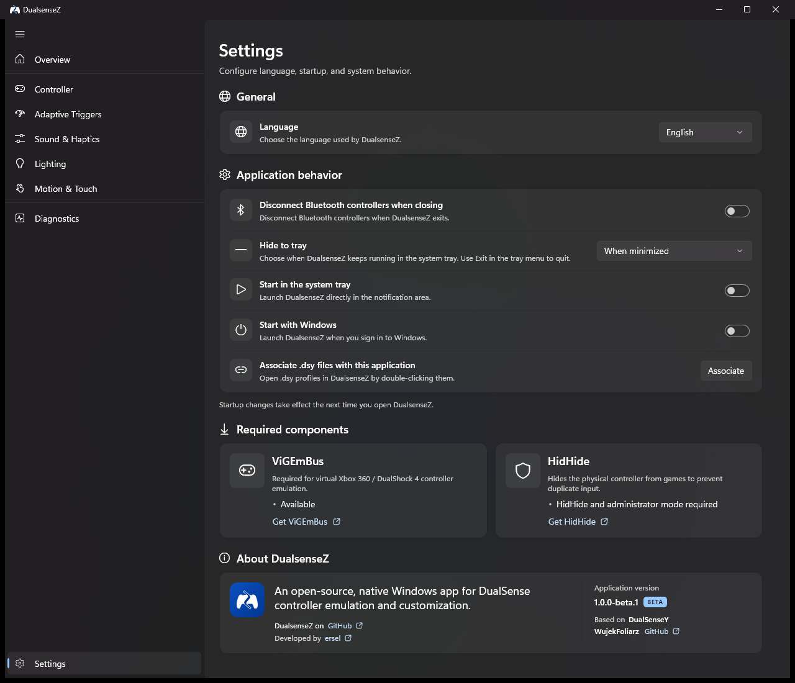

# DualsenseZ

An open-source, native Windows app for DualSense controller emulation and customization.

[Türkçe](README.tr.md)



DualsenseZ is built on [WujekFoliarz/DualSenseY-v2](https://github.com/WujekFoliarz/DualSenseY-v2). The controller, emulation, audio and UDP core comes from that project; DualsenseZ replaces its ImGui interface with a native one written in C++ with WinUI 3 (Windows App SDK).

> **Beta.** This is version 1.0.0-beta.2. Expect rough edges and please report what you find.

## Features

- Xbox 360 and DualShock 4 controller emulation through ViGEmBus
- Adaptive trigger effects and presets
- Audio passthrough to haptics, speaker and microphone settings
- Lightbar modes (battery-based, color cycle, static color), brightness and player LEDs
- Gyro to stick or mouse, touchpad as mouse
- Stick deadzones with a live preview
- UDP support for games with DualSense mods
- Profiles saved and loaded as `.dsy` files
- Game profiles that switch automatically when a game starts, shown as a shelf of covers
- Update notice when a newer release is available
- Start with Windows, hide to tray
- English and Turkish interface

## Screenshots

| Lighting | Settings |
| --- | --- |
|  |  |

## Requirements

- Windows 11
- [ViGEmBus](https://github.com/nefarius/ViGEmBus) for controller emulation
- [HidHide](https://github.com/nefarius/HidHide) and administrator mode, only if you want to hide the physical controller from games

## Install

Download the latest zip from the [Releases page](https://github.com/erselkisbet/DualsenseZ/releases), extract it anywhere and run `DualsenseZ.exe`. Nothing else needs to be installed; the Windows App SDK files ship in the same folder. Settings are stored in `Documents\DualsenseZ`.

## Build

You need Visual Studio 2022 (or newer) C++ Build Tools, a Windows 11 SDK (10.0.22621.0 or newer), CMake and Ninja. From the repository root, in PowerShell:

```powershell
.\scripts\build-winui.ps1
```

- `-SkipRestore` skips the NuGet restore once the packages are in place (the first build needs network access).
- `-Clean` rebuilds everything.

The app is built to `winui\bin\x64\Release\DualsenseZ.exe`. `scripts\build.ps1` builds only the shared core library.

To produce a release zip without debug symbols:

```powershell
.\scripts\package.ps1
```

### Tests

```powershell
.\build\CoreBoundaryTests.exe
python tests\check_winui_strings.py
```

Close DualsenseZ and disconnect controllers before running `CoreBoundaryTests.exe`.

## Credits

- [DualSenseY-v2](https://github.com/WujekFoliarz/DualSenseY-v2) by WujekFoliarz, the original project
- [SAxense](https://github.com/egormanga/SAxense), wireless haptics
- Libraries under `thirdparty/`; see [THIRD-PARTY-NOTICES.md](THIRD-PARTY-NOTICES.md)

## License

MIT. See [LICENSE](LICENSE).

DualsenseZ is not affiliated with or endorsed by Sony Interactive Entertainment. DualSense, DualShock and PlayStation are trademarks of Sony Interactive Entertainment.
