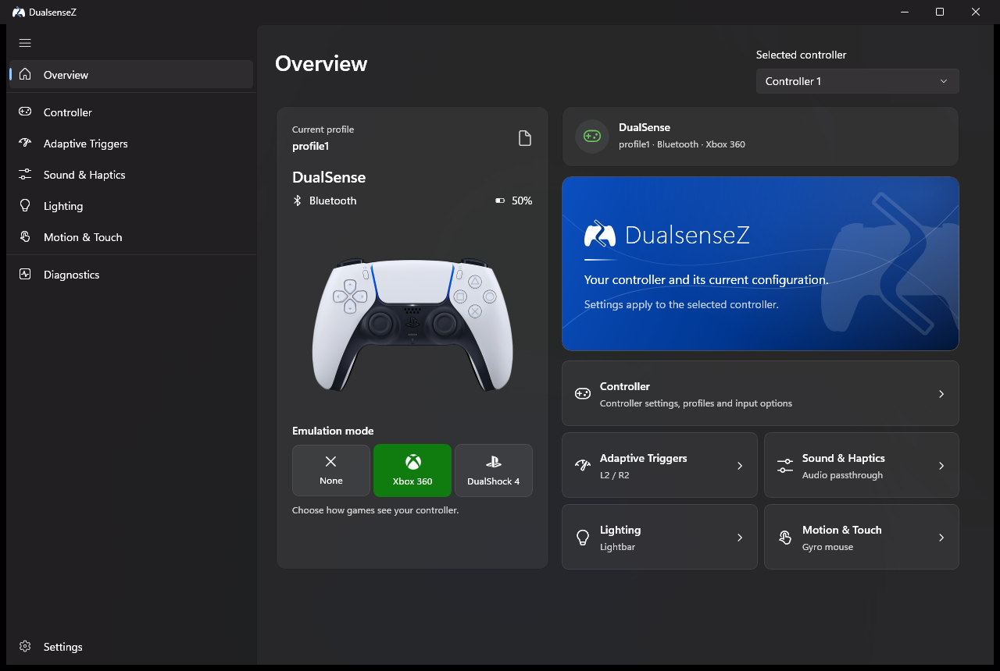
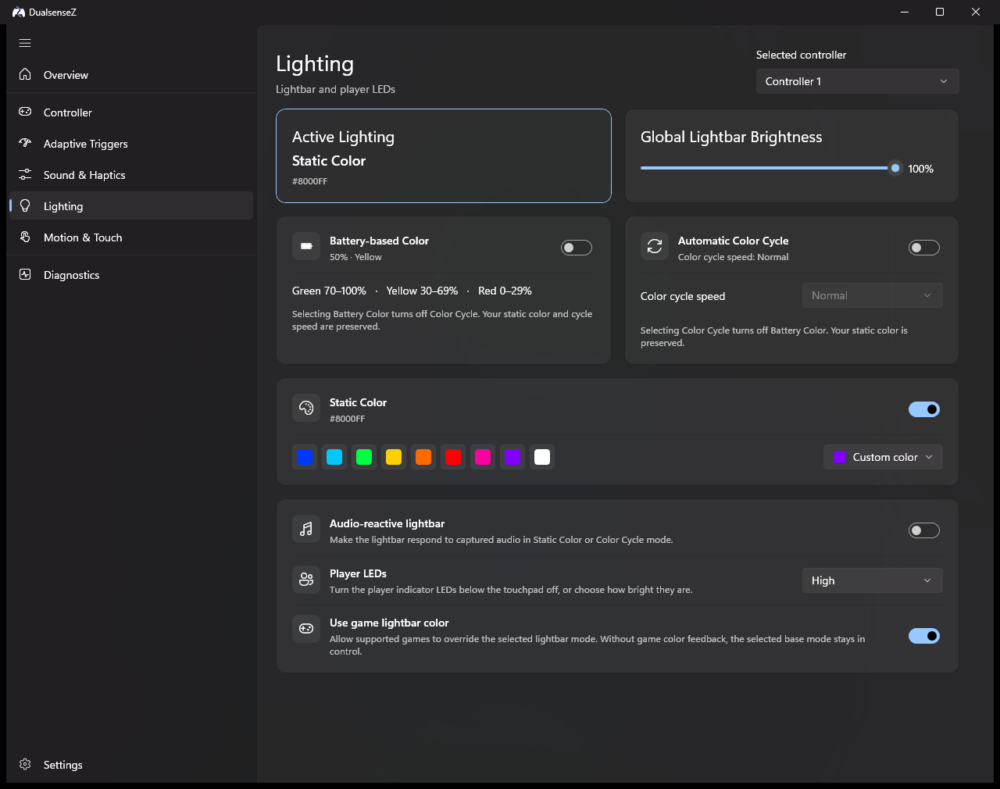
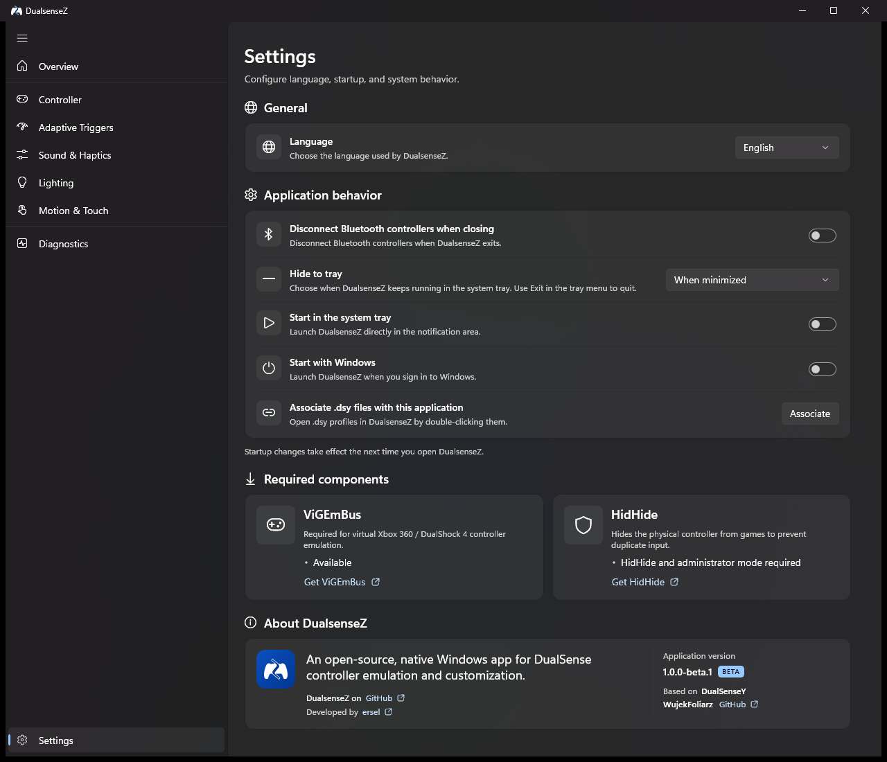

# DualsenseZ

DualSense kontrolcü emülasyonu ve özelleştirmesi için açık kaynaklı, yerel bir Windows uygulaması.

[English](README.md)



DualsenseZ, [WujekFoliarz/DualSenseY-v2](https://github.com/WujekFoliarz/DualSenseY-v2) projesinin üzerine geliştirilmiştir. Kontrolcü, emülasyon, ses ve UDP çekirdeği özgün projeden gelir; DualsenseZ, ImGui arayüzünün yerine C++ ve WinUI 3 (Windows App SDK) ile yazılmış yerel bir arayüz koyar.

> **Beta.** Bu sürüm 1.0.0-beta.1'dir. Pürüzler olabilir; karşılaştıklarınızı bildirin.

## Özellikler

- ViGEmBus üzerinden Xbox 360 ve DualShock 4 kontrolcü emülasyonu
- Adaptif tetik efektleri ve hazır ayarlar
- Sesi titreşime aktarma, hoparlör ve mikrofon ayarları
- Işık çubuğu modları (pile göre renk, renk döngüsü, sabit renk), parlaklık ve oyuncu LED'leri
- Jiroskopu çubuk veya fare olarak kullanma, dokunmatik yüzeyi fare olarak kullanma
- Canlı önizlemeli çubuk ölü bölgeleri
- DualSense modlu oyunlar için UDP desteği
- `.dsy` dosyalarıyla profil kaydetme ve yükleme
- Windows ile başlatma, tepsiye gizleme
- Türkçe ve İngilizce arayüz

## Ekran görüntüleri

| Aydınlatma | Ayarlar |
| --- | --- |
|  |  |

## Gereksinimler

- Windows 11
- Kontrolcü emülasyonu için [ViGEmBus](https://github.com/nefarius/ViGEmBus)
- Yalnızca fiziksel kontrolcüyü oyunlardan gizlemek isterseniz [HidHide](https://github.com/nefarius/HidHide) ve yönetici modu

## Kurulum

[Releases sayfasından](https://github.com/erselkisbet/DualsenseZ/releases) son zip dosyasını indirin, istediğiniz yere çıkarın ve `DualsenseZ.exe` dosyasını çalıştırın. Başka bir şey kurmanız gerekmez; Windows App SDK dosyaları aynı klasörde gelir. Ayarlar `Belgeler\DualsenseZ` altında saklanır.

## Derleme

Visual Studio 2022 (veya daha yeni) C++ Build Tools, bir Windows 11 SDK (10.0.22621.0 veya daha yeni), CMake ve Ninja gerekir. Depo kökünde PowerShell ile:

```powershell
.\scripts\build-winui.ps1
```

- `-SkipRestore`: NuGet paketleri zaten geri yüklendiyse (ilk derleme ağ erişimi ister).
- `-Clean`: her şeyi yeniden derler.

Uygulama `winui\bin\x64\Release\DualsenseZ.exe` olarak derlenir. `scripts\build.ps1` yalnızca ortak çekirdek kütüphanesini derler.

Hata ayıklama simgeleri olmadan sürüm zip'i üretmek için:

```powershell
.\scripts\package.ps1
```

### Testler

```powershell
.\build\CoreBoundaryTests.exe
python tests\check_winui_strings.py
```

`CoreBoundaryTests.exe` çalıştırmadan önce DualsenseZ'yi kapatın ve kontrolcüleri çıkarın.

## Teşekkür

- [DualSenseY-v2](https://github.com/WujekFoliarz/DualSenseY-v2) — WujekFoliarz, özgün proje
- [SAxense](https://github.com/egormanga/SAxense) — kablosuz haptik
- `thirdparty/` altındaki kütüphaneler; bkz. [THIRD-PARTY-NOTICES.md](THIRD-PARTY-NOTICES.md)

## Lisans

MIT — bkz. [LICENSE](LICENSE).

DualsenseZ, Sony Interactive Entertainment ile bağlantılı değildir ve onun tarafından desteklenmemektedir. DualSense, DualShock ve PlayStation, Sony Interactive Entertainment'ın ticari markalarıdır.
